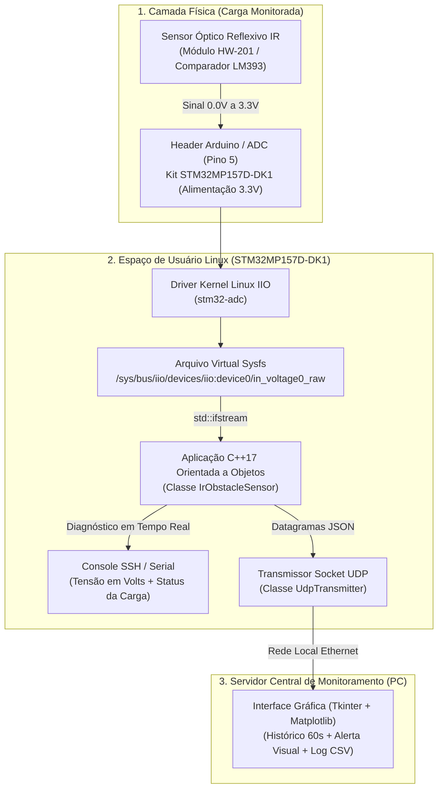
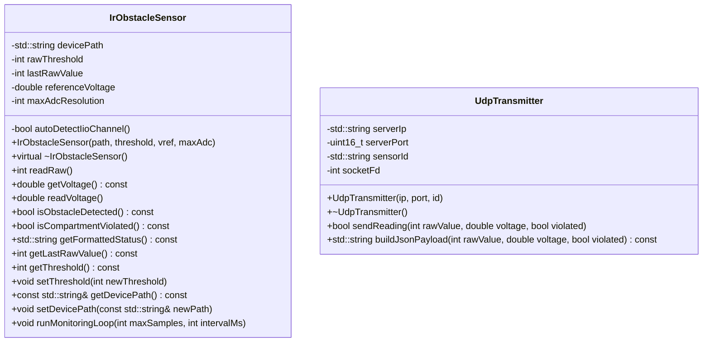

# Monitoramento Inteligente de Carga Sensível — STM32MP157D-DK1 & Linux IIO

[](https://github.com/VPariz/stm32-projeto-final-prog-aplicada/actions/workflows/ci.yml)
[](https://www.st.com/en/evaluation-tools/stm32mp157d-dk1.html)
[](https://www.kernel.org/doc/html/latest/driver-api/iio/index.html)
[](https://isocpp.org/)
[](LICENSE)

**Instituto Militar de Engenharia — IME**  
**Seção de Engenharia Elétrica — SE/3**  
**Disciplina:** Programação Aplicada à Engenharia Elétrica (SE/3 - Eletrônica)  
**Autor:** João Victor Tavares Pariz ([@VPariz](https://github.com/VPariz))  
**Hardware Alvo:** Kit de Desenvolvimento STMicroelectronics **STM32MP157D-DK1** (Linux Embarcado)  
**Sensor Utilizado:** Módulo Sensor de Obstáculo Infravermelho Reflexivo (**HW-201 / LM393**)  

---

## 📂 Índice de Entregas (Acesso Rápido)

| Etapa | Pasta Dedicada | Descrição e Evidências | Status |
| :--- | :--- | :--- | :---: |
| **Entrega 0** | [`entregas/entrega0_conexao_fisica/`](entregas/entrega0_conexao_fisica/) | Fotos da conexão física segura nos headers (`3V3`, `GND` e `ADC`) com o kit desligado. | ✅ Concluída |
| **Entrega 1** | [`entregas/entrega1_classe_sensor_doxygen/`](entregas/entrega1_classe_sensor_doxygen/) | Classe C++ `IrObstacleSensor` encapsulada (zero variáveis globais) + Documentação Doxygen. | ✅ Concluída |
| **Entrega 2** | **[`entregas/entrega2_execucao_embarcada/`](entregas/entrega2_execucao_embarcada/)** | **Programa funcional no kit STM32MP1 com leitura IIO do sensor + Instruções de compilação e execução.** | ✅ **Concluída** |
| **Entrega 3** | [`entregas/entrega3_telemetria_udp/`](entregas/entrega3_telemetria_udp/) | Envio contínuo em tempo real via socket UDP e especificação do protocolo. | ✅ Pronta |
| **Entrega 4** | [`entregas/entrega4_interface_grafica/`](entregas/entrega4_interface_grafica/) | Interface gráfica em Python (tempo real, histórico de 60s, alerta visual e log CSV). | ✅ Pronta |

---

## 🎯 1. Contexto e Descrição Geral do Projeto

No contexto de operações logísticas do **Exército Brasileiro**, o transporte de cargas sensíveis exige monitoramento remoto, contínuo e discreto contra tentativas de violação física, abertura não autorizada ou comprometimento de integridade durante o deslocamento.

Este projeto implementa uma solução embarcada em **C++17 estritamente Orientada a Objetos** (sem variáveis globais e sem lógica fora das classes definidas), executada em espaço de usuário Linux no kit **STM32MP157D-DK1** (Dual ARM Cortex-A7 @ 800 MHz). A aplicação lê continuamente o conversor A/D através do subsistema **Linux Industrial I/O (IIO)** (`/sys/bus/iio/devices/iio:device0/in_voltageX_raw`), converte a leitura bruta em tensão física ($0{,}00\text{ V}$ a $3{,}30\text{ V}$) e detecta em tempo real qualquer violação da tampa do compartimento de carga.

---

## 🗺️ 2. Fluxograma e Arquitetura do Sistema



---

## 📦 3. Diagrama de Classes UML e Estrutura do Código

O projeto obedece rigorosamente aos pilares de Programação Orientada a Objetos (**Encapsulamento, Abstração e Modularidade**), não utilizando variáveis globais nem funções soltas fora de classes:



### Explicação das Classes e Métodos Principais
* **Classe `IrObstacleSensor`** ([`include/IrObstacleSensor.hpp`](include/IrObstacleSensor.hpp) e [`src/IrObstacleSensor.cpp`](src/IrObstacleSensor.cpp)):
  * **Atributos Privados:** `devicePath` (caminho do canal IIO no `sysfs`), `rawThreshold` (limiar digital ADC de decisão, padrão `2000`), `lastRawValue` (última leitura bruta de 12 bits), `referenceVoltage` ($3{,}3\text{ V}$) e `maxAdcResolution` ($4095$).
  * `readRaw()`: Abre e lê o valor numérico bruto do arquivo `/sys/bus/iio/devices/iio:device0/in_voltageX_raw`. Caso o canal padrão não esteja disponível, aciona automaticamente `autoDetectIioChannel()` para varrer os canais IIO ativos na placa.
  * `getVoltage()` / `readVoltage()`: Converte a leitura bruta de 12 bits ($0$ a $4095$) para unidades físicas de tensão elétrica ($0{,}00\text{ V}$ a $3{,}30\text{ V}$) segundo a relação $V = \frac{\text{ADC}}{4095} \times 3{,}3\text{ V}$.
  * `isObstacleDetected()`: Verifica se há reflexão infravermelha na tampa interna (`lastRawValue < rawThreshold`, lógica *active-low* do comparador LM393).
  * `isCompartmentViolated()`: Retorna `true` quando a tampa do compartimento é aberta/violada (ausência de reflexão IR $\rightarrow$ saída vai para nível lógico alto $\approx 3{,}3\text{ V}$).
  * `getFormattedStatus()`: Monta a string completa de diagnóstico contendo leitura bruta, tensão em Volts, estado do obstáculo e condição de segurança da carga.
  * `runMonitoringLoop(maxSamples, intervalMs)`: Executa o laço contínuo de aquisição em tempo real e impressão formatada no terminal.
* **Ponto de Entrada ([`src/main.cpp`](src/main.cpp)):** Instancia o objeto `IrObstacleSensor` dentro de bloco `try/catch` e delega integralmente a execução ao método `sensor.runMonitoringLoop()`.

---

## 🛠️ 4. Dependências Necessárias

1. **Ambiente de Compilação Cruzada (Host Linux / Máquina Virtual VirtualBox):**
   * Toolchain oficial fornecida na disciplina: `arm-buildroot-linux-gnueabihf_sdk-DK2.tar.gz` (`arm-buildroot-linux-gnueabihf-g++` com suporte a C++17 e sysroot embarcado) ou pacote `g++-arm-linux-gnueabihf`.
   * Utilitários `make`, `ssh` e `scp` (OpenSSH Client).
2. **Ambiente de Testes Nativos e Documentação:**
   * Compilador `g++` com suporte a `-std=c++17`.
   * `doxygen` (para geração da documentação automática a partir do [`Doxyfile`](Doxyfile)).
   * Python 3 + `matplotlib` / `tkinter` (para interface gráfica e scripts de apoio em [`requirements.txt`](requirements.txt)).

---

## 🚀 5. Instruções de Compilação e Execução (Entrega 2)

### Etapa A — Configuração da Toolchain de Compilação Cruzada (VM Linux)
Extraia a toolchain oficial fornecida (`arm-buildroot-linux-gnueabihf_sdk-DK2.tar.gz`) na máquina virtual Linux e adicione o diretório `bin` ao `PATH`:

```bash
tar -xvf arm-buildroot-linux-gnueabihf_sdk-DK2.tar.gz
export PATH=$PWD/arm-buildroot-linux-gnueabihf_sdk-DK2/bin:$PATH
```

### Etapa B — Compilação Cruzada do Programa para o Kit STM32MP1 (ARM Cortex-A7)
Na raiz do repositório, compile o executável binário para a arquitetura ARM da placa utilizando qualquer uma das três opções equivalentes abaixo:

```bash
# Opção 1 — Script automatizado (localiza a toolchain e valida o binário ELF ARM):
bash scripts/cross_build.sh

# Opção 2 — Via Makefile (alvo cross):
make cross

# Opção 3 — Comando direto com o compilador cruzado da toolchain:
arm-buildroot-linux-gnueabihf-g++ -Wall -Wextra -std=c++17 -O2 \
    -Iinclude src/IrObstacleSensor.cpp src/main.cpp -o app_sensor_arm
```
> O binário gerado (`app_sensor_arm`) é um executável ELF 32-bit LSB para `ARM, EABI5 version 1 (SYSV)`, pronto para execução no espaço de usuário Linux da placa STM32MP157D-DK1.

### Etapa C — Acesso ao Kit de Desenvolvimento e Descoberta do Canal ADC
1. **Alimentação:** Conecte o cabo USB-C na porta `PWR_IN` (certificando-se de que o sensor foi conectado com o kit desligado e alimentado **exclusivamente em 3,3 V**).
2. **Acesso via Serial (TeraTerm) ou Rede (SSH):**
   * **Via Serial:** Conecte o cabo Micro-USB na porta `ST-LINK / USB Serial`, abra o TeraTerm na porta COM correspondente com Baudrate `115200`, formato `8N1`.
   * **Via Ethernet (SSH):** Conecte o cabo RJ45, configure o IP do PC na mesma sub-rede (`192.168.42.10`) e acesse a placa (`192.168.42.2`):
     ```bash
     ssh root@192.168.42.2
     # Credenciais padrão -> usuário: root | senha: root
     ```
3. **Verificação do Canal IIO do ADC na Placa:**
   No terminal do kit, consulte os canais do conversor A/D expostos pelo subsistema Industrial I/O (IIO):
   ```bash
   ls /sys/bus/iio/devices/iio:device0/
   cat /sys/bus/iio/devices/iio:device0/in_voltage0_raw
   ```

### Etapa D — Transferência (`scp`) e Execução no Kit STM32MP157D-DK1
1. **Transferir o binário compilado do PC/VM para o diretório `/home/root` da placa:**
   ```bash
   # Via comando SCP direto:
   scp app_sensor_arm root@192.168.42.2:/home/root/

   # Ou utilizando o script automatizado de deploy:
   bash scripts/deploy_to_board.sh 192.168.42.2
   ```
2. **Executar o programa diretamente no Kit de Desenvolvimento:**
   No terminal da placa (via SSH ou TeraTerm Serial):
   ```bash
   cd /home/root
   chmod +x app_sensor_arm

   # Execução em loop contínuo em tempo real (Ctrl+C para encerrar):
   ./app_sensor_arm /sys/bus/iio/devices/iio:device0/in_voltage0_raw

   # Ou especificando uma quantidade fixa de leituras (ex.: 10 amostras):
   ./app_sensor_arm /sys/bus/iio/devices/iio:device0/in_voltage0_raw 10
   ```
   *(Observação: Caso o caminho do canal não seja informado como argumento, a classe `IrObstacleSensor` utiliza `/sys/bus/iio/devices/iio:device0/in_voltage0_raw` por padrão e realiza autodetecção automática entre os canais `in_voltageX_raw` disponíveis).*

### Etapa E — Compilação Nativa e Simulação Local no PC (Bancada)
Para testar rapidamente a lógica da classe no próprio computador sem a placa física:
```bash
# 1. Compilar binário nativo (gera ./app_sensor):
make clean && make

# 2. Executar o simulador de sensor em segundo plano (alterna tampa fechada/aberta):
python3 scripts/mock_sensor.py mock_sensor_raw.txt 2 &

# 3. Executar a aplicação lendo os dados simulados:
./app_sensor mock_sensor_raw.txt 10
```

---

## 📊 6. Saída do Programa e Análise dos Valores Medidos

Durante a execução do binário `app_sensor_arm`, a classe realiza a leitura do registrador `in_voltageX_raw` (escala de 12 bits: $0$ a $4095$ ou de 16 bits conforme configuração do driver `stm32-adc`) e converte para tensão elétrica com referência de $3{,}30\text{ V}$:

```text
[0001] [SENSOR HW-201] Bruto: 850 (0.68 V) | Obstaculo: PRESENTE | Carga: INTEGRA (SEGURA)
[0002] [SENSOR HW-201] Bruto: 842 (0.68 V) | Obstaculo: PRESENTE | Carga: INTEGRA (SEGURA)
[0003] [SENSOR HW-201] Bruto: 855 (0.69 V) | Obstaculo: PRESENTE | Carga: INTEGRA (SEGURA)
[0004] [SENSOR HW-201] Bruto: 3600 (2.90 V) | Obstaculo: AUSENTE | Carga: VIOLACAO DETECTADA!
[0005] [SENSOR HW-201] Bruto: 3625 (2.92 V) | Obstaculo: AUSENTE | Carga: VIOLACAO DETECTADA!
```

| Condição Física do Compartimento | Reflexão IR no Sensor HW-201 | Leitura Bruta ADC (`in_voltageX_raw`) | Tensão Calculada ($V$) | Diagnóstico da Classe `IrObstacleSensor` |
| :--- | :---: | :---: | :---: | :--- |
| **Tampa Fechada (Normal)** | Presente (feixe refletido) | $< 2000$ (tip. $100 \text{ a } 900$) | $\approx 0{,}08\text{ V a } 0{,}75\text{ V}$ | `Obstaculo: PRESENTE \| Carga: INTEGRA (SEGURA)` |
| **Tampa Aberta (Violação)** | Ausente (feixe livre) | $\ge 2000$ (tip. $3500 \text{ a } 4095$) | $\approx 2{,}80\text{ V a } 3{,}30\text{ V}$ | `Obstaculo: AUSENTE \| Carga: VIOLACAO DETECTADA!` |

---

## 🔌 7. Registro das Entregas Anteriores (Entrega 0 e Entrega 1)

### Entrega 0 — Conexão Física Segura (Kit Desligado e Alimentação 3,3 V)
| Pino no Sensor HW-201 | Conector na Placa STM32MP157D-DK1 | Posição Exata (da direita p/ esquerda) |
| :--- | :--- | :--- |
| **VCC** (Alimentação) | Bloco da Direita (8 furos — Power) | **Pino 4** (`3V3` — **Estritamente 3,3 V**) |
| **GND** (Terra) | Bloco da Direita (8 furos — Power) | **Pino 7** (`GND`) |
| **OUT** (Sinal) | Bloco da Esquerda (6 furos — Analog) | **Pino 5** (Entrada `ADC`) |

* Evidências fotográficas da montagem com o kit desligado: [`docs/conexao_placa_desligada.jpg`](docs/conexao_placa_desligada.jpg) e [`docs/conexao_sensor_pinos.jpg`](docs/conexao_sensor_pinos.jpg).

### Entrega 1 — Documentação Automática Doxygen
Para regenerar a documentação HTML da classe `IrObstacleSensor`:
```bash
doxygen Doxyfile
# ou:
make doc
```
* A documentação compilada está disponível em [`docs/doxygen/html/index.html`](docs/doxygen/html/index.html).

---

## 📁 8. Estrutura de Diretórios do Repositório

```text
├── include/
│   ├── IrObstacleSensor.hpp               # Declaração da classe C++ do sensor documentada com Doxygen
│   └── UdpTransmitter.hpp                 # Declaração da classe transmissora UDP (Entrega 3)
├── src/
│   ├── IrObstacleSensor.cpp               # Implementação da leitura IIO, conversão e diagnóstico
│   ├── UdpTransmitter.cpp                 # Implementação de envio via socket UDP (Entrega 3)
│   └── main.cpp                           # Ponto de entrada enxuto da aplicação embarcada
├── scripts/
│   ├── cross_build.sh                     # Script de compilação cruzada ARM (arm-buildroot-linux-gnueabihf)
│   ├── deploy_to_board.sh                 # Script de transferência SCP e permissão de execução na placa
│   └── mock_sensor.py                     # Simulador de arquivo IIO para testes locais em bancada
├── gui/
│   ├── gui_dashboard.py                   # Interface gráfica Tkinter/Matplotlib (Entrega 4)
│   └── test_udp_receiver.py               # Receptor UDP de terminal para validação de pacotes
├── entregas/                              # Pastas dedicadas para cada entrega (Entrega 0 a Entrega 4)
│   ├── entrega0_conexao_fisica/
│   ├── entrega1_classe_sensor_doxygen/
│   ├── entrega2_execucao_embarcada/
│   ├── entrega3_telemetria_udp/
│   └── entrega4_interface_grafica/
├── docs/
│   ├── conexao_placa_desligada.jpg        # Foto da conexão nos headers com o kit desligado
│   ├── conexao_sensor_pinos.jpg           # Foto da conexão nos pinos do sensor HW-201
│   └── doxygen/html/                      # Documentação Doxygen gerada em HTML
├── Doxyfile                               # Configuração do Doxygen
├── Makefile                               # Regras de compilação nativa (make) e cruzada ARM (make cross)
├── requirements.txt                       # Dependências Python para a interface gráfica
└── README.md                              # Documentação principal do projeto
```

---

## 📜 Licença
Distribuído sob a Licença **MIT** — consulte o arquivo [`LICENSE`](LICENSE) para mais informações.
