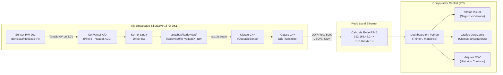
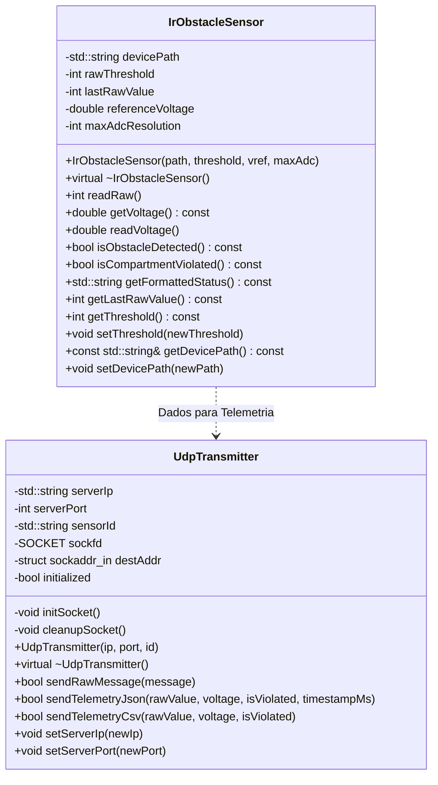

# Monitoramento Inteligente de Carga Sensivel (IoT)

**Instituto Militar de Engenharia — IME**  
**Secao de Engenharia Eletrica — SE/3**  
**Disciplina:** Programacao Aplicada a Engenharia Eletrica (SE/3 - Eletronica)  
**Hardware Alvo:** Kit Discovery STMicroelectronics STM32MP157D-DK1 (Linux Embarcado)  
**Sensor Alocado (Nº 3):** Modulo Sensor de Obstaculo Infravermelho Reflexivo Digital (HW-201 / LM393)  

---

## 👥 Integrantes do Grupo
* **Joao Victor Pariz**
* [Integrante 2]
* [Integrante 3]

---

## 📅 Cronograma Oficial e Critérios de Pontuação (Classroom 2026)

Conforme comunicado oficial divulgado pela Seção de Engenharia Elétrica (SE/3):
* **Escala Global da Matéria:** 10.000 pontos no total.
* **Projeto Final (VF):** 4.000 pontos no total, distribuídos igualmente em **5 entregas parciais de 800 pontos cada**.
* **Listas de Exercícios (VC / VEs):** 6.000 pontos no total.

| Etapa | Data / Prazo Limite | Pontos | Descrição no Classroom | Status / O que falta |
| :---: | :---: | :---: | :--- | :--- |
| **Entrega 0** | 19/10/2026 | Concluída | Conexão física com o kit desligado e fotos dos headers | ✅ Concluída |
| **Entrega 1** | **26/10/2026, 23:59** | **800 pts** | Classe C++ (`IrObstacleSensor`) com Doxygen no Git. **"Precisa funcionar na placa, mesmo q leia errado."** | 🚀 **Pronto p/ envio Git** |
| **Entrega 2** | **02/11/2026, 23:59** | **800 pts** | Programa funcional no kit STM32MP157D-DK1 com instruções de compilação/execução no README | 🟡 Código pronto; falta teste de bancada |
| **Entrega 3** | **09/11/2026, 23:59** | **800 pts** | Envio da leitura via pacotes UDP para servidor e documentação do protocolo | 🟡 Código e scripts prontos |
| **Entrega 4** | **16/11/2026, 23:59** | **800 pts** | Interface gráfica (GUI) no PC para visualização em tempo real | 🟡 Dashboard Python pronto |
| **Entrega 5** | **16/11/2026, 23:59** | **800 pts** | Vídeo de demonstração do sistema operando de ponta a ponta e apresentação | 🟡 Roteiro pronto |

> [!IMPORTANT]
> **Esclarecimento Oficial da Entrega 1 (26 de Outubro):**
> Em resposta a questionamento de alunos no Google Classroom (*"Para essa entrega, é necessário que a classe funcione na placa ou basta funcionar no computador com dados simulados?"*), a coordenação docente respondeu enfaticamente: **"Precisa funcionar na placa, mesmo q leia errado."**
> Portanto, além de ser compilável e documentada no Doxygen, a classe `IrObstacleSensor` deve realizar a leitura atômica do nó virtual `/sys/bus/iio/devices/iio:device0/in_voltageX_raw` no Linux embarcado da placa.

---

## 🎯 Contexto e Missao do Projeto
No ambito das operacoes logisticas do Exercito Brasileiro, o transporte de cargas sensiveis exige monitoramento remoto, continuo e discreto contra tentativas de violacao, abertura nao autorizada ou comprometimento fisico.

Este projeto implementa uma solucao integrada de Internet das Coisas (IoT) com as seguintes camadas:
1. **Camada Embarcada:** Um programa em C++ orientado a objetos rodando em espaco de usuario no Linux da placa **STM32MP157D-DK1**, realizando a aquisicao de dados do sensor infravermelho reflexivo **HW-201** atraves do subsistema de arquivos do Kernel **IIO (Industrial I/O)**.
2. **Camada de Telemetria:** Transmissao continua e em tempo real dos dados de telemetria via **datagramas UDP** atraves da interface de rede Ethernet cabeada (RJ45).
3. **Camada de Supervisao (PC):** Uma interface grafica interativa (GUI) com dashboard em tempo real, plotagem de grafico temporal deslizante dos ultimos 60 segundos, alerta visual imediato de violacao e exportacao continua para arquivo CSV.

---

## 🗺️ Arquitetura do Sistema



---

## 📦 Diagrama de Classes UML (POO Estrita)



---

## 📅 Cronograma Oficial de Entregas

| Etapa | Prazo Limite | Pontos | Resumo do Entregavel |
| :---: | :---: | :---: | :--- |
| **Entrega 0** | **19/10/2026** | Obrig. | Foto nítida da conexão física com o kit **totalmente desligado**. |
| **Entrega 1** | **26/10/2026** | 2,0 pts | Código-fonte C++ da classe de leitura com Doxygen no GitHub. |
| **Entrega 2** | **02/11/2026** | 2,0 pts | Executável funcional rodando na placa via SSH + prints no README. |
| **Entrega 3** | **09/11/2026** | 2,0 pts | Envio contínuo via socket UDP + documentação formal do protocolo. |
| **Entrega 4** | **16/11/2026** | 2,0 pts | Interface gráfica (GUI) no computador com gráfico e salvamento de CSV. |
| **Entrega 5** | **16/11/2026** | 2,0 pts | **Mesma data da Entrega 4!** Vídeo demonstrativo, apresentação e integração. |

---

## 🔌 Entrega 0 — Conexão Física Segura (Hardware Desligado)

### ⚠️ Regras Críticas de Segurança
1. **Alimentação estritamente em 3,3 V:** O sensor HW-201 **jamais deve ser alimentado em 5V**. O processador STM32MP1 opera em nível lógico de 3,3 V; tensões de 5V danificam permanentemente o conversor A/D da placa.
2. **Preservação do microSD:** Não remova o cartão microSD inserido na placa sob nenhuma hipótese.
3. **Placa 100% Desligada:** A conexão dos fios deve ser efetuada com a placa desconectada de cabos USB e de energia.

### Esquema de Ligação (Conectores Header da STM32MP157D-DK1)
Com a placa virada com os conectores fêmea na borda inferior e o cartão microSD apontando para a esquerda, a contagem dos furos ocorre **da direita para a esquerda**:

| Pino no Sensor HW-201 | Cor do Jumper | Conector na Placa STM32MP1 | Posição Exata |
| :--- | :--- | :--- | :--- |
| **VCC** (Alimentação) | Cinza / Vermelho | **Bloco da Direita (8 furos)** | **Pino 4** (serigrafia `3V3`) |
| **GND** (Terra) | Branco / Preto | **Bloco da Direita (8 furos)** | **Pino 7** (serigrafia `GND`) |
| **OUT / D0** (Sinal) | Preto / Laranja | **Bloco da Esquerda (6 furos)** | **Pino 5** (Entrada ADC) |

### Evidências Fotográficas da Entrega 0
* Foto da placa desligada com conexões nos headers: [`docs/conexao_placa_desligada.jpg`](docs/conexao_placa_desligada.jpg)
* Foto do sensor conectado nos pinos VCC, GND e OUT: [`docs/conexao_sensor_pinos.jpg`](docs/conexao_sensor_pinos.jpg)

---

## 💻 Entrega 1 — Modelagem POO em C++ e Doxygen

### Princípio da Lógica Active-Low do Sensor HW-201
O sensor de obstáculo reflexivo HW-201 possui um comparador LM393 e um trimpot de ajuste:
* **Tampa Fechada (Carga Íntegra):** O feixe infravermelho reflete na tampa do baú e retorna ao fototransistor receptor $\rightarrow$ A saída comuta para **Nível Lógico BAIXO (0 V / ADC $\approx$ 0 a 300)**.
* **Tampa Aberta (Violação):** O feixe se propaga livremente, sem reflexão $\rightarrow$ A saída comuta para **Nível Lógico ALTO (3,3 V / ADC $\approx$ 4000 a 4095)**, disparando o alarme de segurança.

### Métodos da Classe `IrObstacleSensor`
* `readRaw()`: Abre o arquivo virtual IIO com `std::ifstream`, lê o valor inteiro e fecha o recurso automaticamente (princípio RAII).
* `getVoltage()`: Converte o valor bruto em Volts ($V = \frac{\text{raw}}{4095} \times 3.3$).
* `isObstacleDetected()`: Retorna `true` se a leitura for inferior ao limiar (`raw < threshold`).
* `isCompartmentViolated()`: Retorna `!isObstacleDetected()` (feixe desimpedido indica compartimento aberto).
* `setThreshold(int)` / `getThreshold()`: Permite ajuste dinâmico do limiar de detecção.

### Geração da Documentação Doxygen
```bash
# Gerar a documentação HTML e LaTeX
doxygen Doxyfile
# Ou via Makefile:
make doc
```
Acesse a documentação completa abrindo `docs/doxygen/html/index.html` em qualquer navegador.

---

## ⚙️ Entrega 2 — Compilação Cruzada e Execução Remota

### 1. Compilação Local no PC (Para testes em casa)
```bash
# Compilar nativamente:
make
# Executar apontando para arquivo simulado:
./app_sensor mock_sensor_raw.txt 127.0.0.1 5000 10
```

### 2. Compilação Cruzada para ARM Cortex-A7 (STM32MP1)
```bash
# Compilar com a toolchain do edital:
make cross
# O arquivo gerado será 'app_sensor_arm'
```

### 3. Deploy e Execução na Bancada do Laboratório
```bash
# 1. Configurar IP fixo na placa de rede do PC: 192.168.42.10 (Mascara 255.255.255.0)
# 2. Transferir o binario via rede para a placa:
scp app_sensor_arm root@192.168.42.2:/home/root/

# 3. Acessar a placa via SSH e executar:
ssh root@192.168.42.2
cd /home/root
chmod +x app_sensor_arm
./app_sensor_arm
```

---

## 📡 Entrega 3 — Protocolo de Telemetria UDP

O programa embarcado transmite datagramas UDP contínuos na porta **`5000`** para o IP do computador central (`192.168.42.10` na bancada ou `127.0.0.1` em testes locais).

### Formato da Mensagem JSON
```json
{
  "sensor_id": "G3_IR_HW201",
  "raw": 150,
  "voltage": 0.12,
  "unit": "V",
  "violated": 0,
  "timestamp": 1729600000000
}
```

### Campos do Protocolo
* `sensor_id` (string): Identificador único do grupo e modelo do sensor (`"G3_IR_HW201"`).
* `raw` (int): Valor bruto lido diretamente do conversor A/D (0 a 4095).
* `voltage` (float): Tensão calculada em Volts com 2 casas decimais.
* `unit` (string): Unidade de medida da grandeza convertida (`"V"`).
* `violated` (int): Flag booleana de segurança (`0` = Carga Íntegra / `1` = Violação Detectada).
* `timestamp` (long long): Carimbo de data/hora em milissegundos UTC.

---

## 🖥️ Entrega 4 — Interface Gráfica de Monitoramento (GUI)

O dashboard de supervisão foi desenvolvido em Python utilizando **Tkinter** e **Matplotlib**:
* **Thread UDP Não-Bloqueante:** Escuta datagramas na porta 5000 sem travar a interface.
* **Banner de Alerta Visual:** Exibe destaque imediato em verde (`CARGA ÍNTEGRA`) ou vermelho piscante (`ALERTA: VIOLAÇÃO DETECTADA!`).
* **Gráfico Deslizante em Tempo Real:** Janela deslizante dos últimos 60 segundos com linha de limiar dinâmico.
* **Registro Contínuo e Exportação CSV:** Salva os eventos em `dados_telemetria_sensor_hw201.csv` com botão de exportação.

### Como Executar a Interface
```bash
python scripts/gui_dashboard.py
```

---

## 📁 Estrutura de Arquivos do Repositório

```text
projeto_final/
├── docs/                                  # Imagens e documentacao
│   ├── conexao_placa_desligada.jpg        # Evidencia da conexao nos headers
│   ├── conexao_sensor_pinos.jpg           # Evidencia da conexao no sensor
│   └── doxygen/html/                      # Site HTML da documentacao do codigo
├── include/                               # Cabecalhos C++ (.hpp)
│   ├── IrObstacleSensor.hpp               # Classe de leitura do sensor IIO
│   └── UdpTransmitter.hpp                 # Classe de transmissao de socket UDP
├── src/                                   # Implementacao C++ (.cpp)
│   ├── IrObstacleSensor.cpp               # Metodos da classe do sensor
│   ├── UdpTransmitter.cpp                 # Metodos do socket UDP
│   └── main.cpp                           # Aplicacao embarcada principal
├── scripts/                               # Utilitarios e interface grafica
│   ├── mock_sensor.py                     # Simulador de hardware local
│   ├── test_udp_receiver.py               # Receptor UDP em terminal
│   └── gui_dashboard.py                   # Interface Grafica (GUI) em Python
├── Doxyfile                               # Configuracao do Doxygen
├── Makefile                               # Build nativo e cross-compilacao ARM
├── Guia_Definitivo_Projeto_Completo.pdf   # Manual didatico completo (15 paginas)
└── README.md                              # Documento central do projeto
```

---

## 📜 Diretrizes Institucionais
Trabalho desenvolvido no âmbito da disciplina de Programação Aplicada à Engenharia Elétrica — **Instituto Militar de Engenharia (IME)** — Seção de Engenharia Elétrica (**SE/3**). Código e documentação estritamente em conformidade com as normas do edital 2026.
