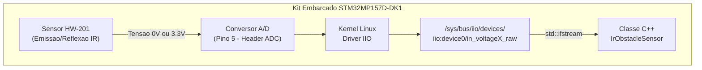
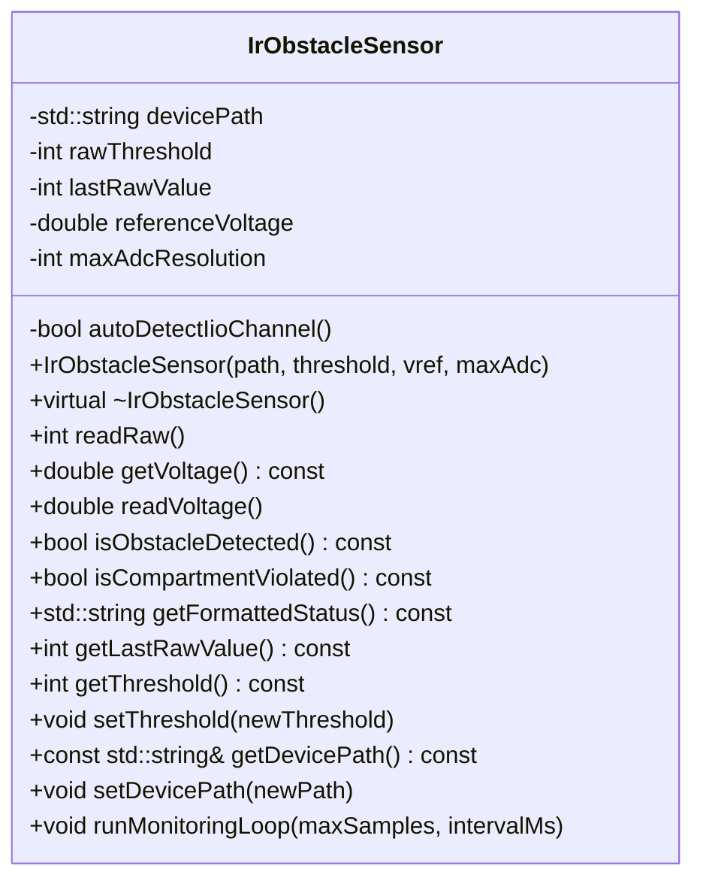

# Monitoramento Inteligente de Carga Sensivel (IoT)

**Instituto Militar de Engenharia — IME**  
**Secao de Engenharia Eletrica — SE/3**  
**Disciplina:** Programacao Aplicada a Engenharia Eletrica (SE/3 - Eletronica)  
**Hardware Alvo:** Kit Discovery STMicroelectronics STM32MP157D-DK1 (Linux Embarcado)  
**Sensor Alocado (Nº 3):** Modulo Sensor de Obstaculo Infravermelho Reflexivo Digital (HW-201 / LM393)  

---

## 👥 Integrantes do Grupo
* **Joao Victor Pariz**
* **Mateus Roma**
* **Daniel Coimbra**

---

## 📂 Organizacao Modular por Entregavel (Acesso Direto)

Para facilitar a correcao e o foco em cada etapa do projeto, cada entregavel possui sua propria pasta dedicada dentro de [`entregas/`](entregas/):

| Etapa | Pasta Dedicada | Conteudo Principal |
| :--- | :--- | :--- |
| **Entrega 0** | [`entregas/entrega0_conexao_fisica/`](entregas/entrega0_conexao_fisica/) | Fotos da conexao nos headers (3,3 V, GND e ADC) com o kit desligado. |
| **Entrega 1** | **[`entregas/entrega1_classe_sensor_doxygen/`](entregas/entrega1_classe_sensor_doxygen/)** | **Classe C++ (`IrObstacleSensor`) com leitura IIO da placa + Doxygen.** |
| **Entrega 2** | [`entregas/entrega2_execucao_embarcada/`](entregas/entrega2_execucao_embarcada/) | Scripts de compilacao cruzada ARM (`arm-buildroot-linux-gnueabihf`) e deploy. |
| **Entrega 3** | [`entregas/entrega3_telemetria_udp/`](entregas/entrega3_telemetria_udp/) | Classe C++ `UdpTransmitter`, receptor de teste e especificacao do protocolo UDP. |
| **Entrega 4** | [`entregas/entrega4_interface_grafica/`](entregas/entrega4_interface_grafica/) | Dashboard grafico em Python (tempo real, historico de 60s, alerta e log CSV). |

---

## 🎯 Contexto e Missao do Projeto
No ambito das operacoes logisticas do Exercito Brasileiro, o transporte de cargas sensiveis exige monitoramento remoto, continuo e discreto contra tentativas de violacao, abertura nao autorizada ou comprometimento fisico.

Este projeto implementa uma solucao embarcada em C++ orientada a objetos rodando em espaco de usuario no Linux da placa **STM32MP157D-DK1**, realizando a aquisicao e interpretacao de dados do sensor infravermelho reflexivo **HW-201** atraves do subsistema de arquivos do Kernel **IIO (Industrial I/O)**.

---

## 🗺️ Arquitetura de Aquisicao Embarcada



---

## 📦 Diagrama de Classe UML (POO Estrita)



---

## 🔌 Entrega 0 — Conexao Fisica Segura (Hardware Desligado)

### Regras Criticas de Seguranca
1. **Alimentacao estritamente em 3,3 V:** O sensor HW-201 e alimentado exclusivamente em 3,3 V (Pino 4), protegendo o conversor A/D do processador STM32MP1.
2. **Montagem Desenergizada:** Conexao realizada com a placa desconectada de fontes de alimentacao e cabos USB.

### Esquema de Ligacao (Conectores Header da STM32MP157D-DK1)
Com a placa posicionada com os conectores femea na borda inferior e o cartao microSD voltado para a esquerda (contagem **da direita para a esquerda**):

| Pino no Sensor HW-201 | Conector na Placa STM32MP1 | Posicao Exata |
| :--- | :--- | :--- |
| **VCC** (Alimentacao) | **Bloco da Direita (8 furos)** | **Pino 4** (serigrafia `3V3`) |
| **GND** (Terra) | **Bloco da Direita (8 furos)** | **Pino 7** (serigrafia `GND`) |
| **OUT / D0** (Sinal) | **Bloco da Esquerda (6 furos)** | **Pino 5** (Entrada ADC) |

### Evidencias Fotograficas
* Conexao nos headers da placa desligada: [`docs/conexao_placa_desligada.jpg`](docs/conexao_placa_desligada.jpg)
* Conexao nos pinos do sensor HW-201: [`docs/conexao_sensor_pinos.jpg`](docs/conexao_sensor_pinos.jpg)

---

## 💻 Entrega 1 — Classe C++ (`IrObstacleSensor`) e Doxygen

### Principio Fisico e Logica Active-Low (HW-201)
O modulo de obstaculo infravermelho reflexivo HW-201 utiliza um par emissor/receptor IR acoplado ao comparador LM393:
* **Compartimento Fechado (Carga Integra):** O feixe infravermelho reflete na face interna da tampa $\rightarrow$ Saida comuta para **Nivel Logico BAIXO (0 V / ADC proximo de 0)**.
* **Compartimento Aberto (Violacao):** O feixe nao sofre reflexao $\rightarrow$ Saida comuta para **Nivel Logico ALTO (3,3 V / ADC proximo de 4095)**.

### Principais Metodos da Classe `IrObstacleSensor`
* `readRaw()`: Realiza a leitura atomica do canal IIO no `sysfs` (`/sys/bus/iio/devices/iio:device0/in_voltageX_raw`) utilizando `std::ifstream` (RAII) e fallback automatico de descoberta de canal (`autoDetectIioChannel()`).
* `getVoltage()` / `readVoltage()`: Converte a leitura bruta na tensao fisica correspondente ($0,0\text{ V}$ a $3,3\text{ V}$).
* `isObstacleDetected()`: Avalia se a leitura esta abaixo do limiar configurado (`lastRawValue < rawThreshold`).
* `isCompartmentViolated()`: Indica violacao do compartimento monitorado (`!isObstacleDetected()`).
* `runMonitoringLoop(maxSamples, intervalMs)`: Executa o ciclo encapsulado de aquisicao e exibicao formatada.

### Geracao da Documentacao Doxygen
```bash
doxygen Doxyfile
# Ou via Makefile:
make doc
```
A documentacao HTML gerada encontra-se disponivel em [`docs/doxygen/html/index.html`](docs/doxygen/html/index.html).

---

## ⚙️ Compilacao e Execucao

### 1. Compilacao Cruzada para a Placa STM32MP1 (ARM Cortex-A7)
```bash
# Utilizando a toolchain oficial arm-buildroot-linux-gnueabihf:
bash scripts/cross_build.sh
# Ou via Makefile:
make cross
```

### 2. Transferencia e Execucao no Kit STM32MP157D-DK1
```bash
# Transferir binario via SCP:
scp app_sensor_arm root@192.168.42.2:/home/root/

# Executar no terminal da placa:
ssh root@192.168.42.2
./app_sensor_arm /sys/bus/iio/devices/iio:device0/in_voltage0_raw
```

### 3. Compilacao e Teste Local (Simulacao no Computador)
```bash
make
./app_sensor mock_sensor_raw.txt 10
```

---

## 📁 Estrutura de Arquivos do Repositorio

```text
projeto_final/
├── entregas/                              # Pastas organizadas por entregavel (0 a 4)
│   ├── entrega0_conexao_fisica/           # Fotos e mapeamento dos pinos 3,3V, GND e ADC
│   ├── entrega1_classe_sensor_doxygen/    # Classe C++ IrObstacleSensor e Doxyfile
│   ├── entrega2_execucao_embarcada/       # Makefile e scripts de cross-compilacao ARM
│   ├── entrega3_telemetria_udp/           # Classe UdpTransmitter e especificacao UDP
│   └── entrega4_interface_grafica/        # Dashboard grafico em Python e simulador
├── docs/                                  # Evidencias e documentacao Doxygen
│   ├── conexao_placa_desligada.jpg        # Conexao nos headers com kit desligado
│   ├── conexao_sensor_pinos.jpg           # Conexao no sensor HW-201
│   └── doxygen/html/                      # Documentacao HTML gerada pelo Doxygen
├── include/
│   └── IrObstacleSensor.hpp               # Declaracao da classe C++ documentada
├── src/
│   ├── IrObstacleSensor.cpp               # Implementacao dos metodos da classe
│   └── main.cpp                           # Ponto de entrada enxuto da aplicacao
├── scripts/
│   ├── cross_build.sh                     # Script de compilacao cruzada ARM
│   ├── deploy_to_board.sh                 # Script de envio via SCP para a placa
│   └── mock_sensor.py                     # Simulador de arquivo IIO para testes locais
├── Doxyfile                               # Arquivo de configuracao do Doxygen
├── Makefile                               # Automacao de build e documentacao
└── README.md                              # Documentacao principal do repositorio
```
