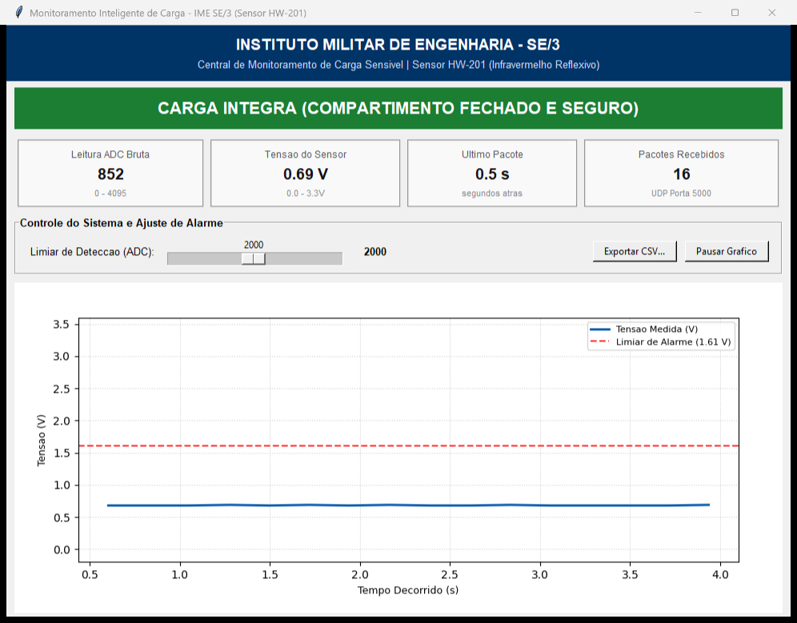
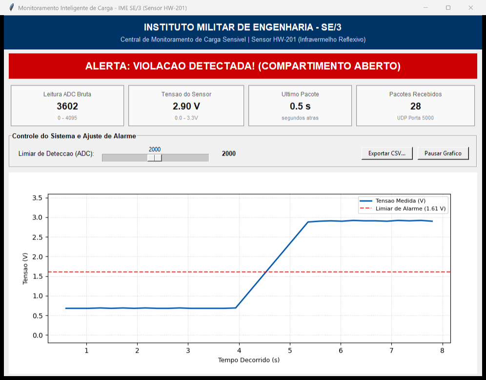

# Entrega 4 — Interface Gráfica (GUI) de Monitoramento no PC

**Instituto Militar de Engenharia — IME**  
**Seção de Engenharia Elétrica — SE/3**  
**Disciplina:** Programação Aplicada à Engenharia Elétrica  
**Autores:** João Victor Tavares Pariz (Grupo 3: Pariz, Mateus Roma e Daniel Coimbra)  

---

## 📌 Arquivos desta Entrega
* [`gui_dashboard.py`](gui_dashboard.py): Interface gráfica em Python (`Tkinter` + `Matplotlib`) com recepção assíncrona via socket UDP (porta `5000`), gráfico temporal deslizante (últimos 60 segundos / 240 amostras a 4 Hz), banner visual de alerta, ajuste dinâmico de limiar, indicador de último pacote e gravação/exportação contínua em CSV.
* [`mock_sensor.py`](mock_sensor.py): Simulador de leituras ADC para testes em bancada sem a placa física.
* [`gui_carga_integra.png`](gui_carga_integra.png) e [`gui_alerta_violacao.png`](gui_alerta_violacao.png): Capturas de tela da interface em operação nos dois estados do compartimento.

---

## 🖥️ Funcionalidades Implementadas
1. **Exibição em Destaque do Status da Carga:**
   * **Verde (`CARGA INTEGRA (COMPARTIMENTO FECHADO E SEGURO)`)** quando `raw < limiar`.
   * **Vermelho (`ALERTA: VIOLACAO DETECTADA! (COMPARTIMENTO ABERTO)`)** quando `raw >= limiar`.
   * **Cinza (`SEM SINAL DE TELEMETRIA`)** se nenhum pacote chegar por mais de `4,0 s`.
2. **Gráfico Temporal Deslizante (60 s):** Plotagem contínua da tensão ($0{,}0\text{ V}$ a $3{,}3\text{ V}$) e da linha tracejada vermelha correspondente ao limiar de alarme.
3. **Ajuste Dinâmico de Limiar (Bônus):** *Slider* de `100` a `4000` ADC que atualiza em tempo real tanto a linha de referência no gráfico quanto o critério de alerta.
4. **Indicador Temporal de Último Pacote (Bônus):** Exibe o tempo decorrido desde a última recepção UDP e o total acumulado de pacotes recebidos.
5. **Persistência em CSV:** Registro automático em `dados_telemetria_sensor_hw201.csv` (`timestamp_iso,sensor_id,adc_raw,voltage_v,violation_flag`) e botão `Exportar CSV...`.

---

## 📸 Capturas de Tela

| Compartimento Fechado (`CARGA ÍNTEGRA`) | Compartimento Aberto (`VIOLAÇÃO DETECTADA`) |
| :---: | :---: |
|  |  |

---

## 🚀 Como Executar
```bash
# Instalar dependências Python (matplotlib >= 3.5.0)
pip install -r ../../requirements.txt

# Iniciar o Dashboard Gráfico (escutando UDP na porta 5000)
python gui_dashboard.py
```

Para testar localmente no PC enviando pacotes C++ via UDP:
```bash
# Terminal 1: Simulador de canal IIO
python mock_sensor.py mock_sensor_raw.txt 3

# Terminal 2: Dashboard GUI
python gui_dashboard.py

# Terminal 3: Aplicação C++17 (da raiz do projeto)
./app_sensor mock_sensor_raw.txt 0 127.0.0.1 5000
```
